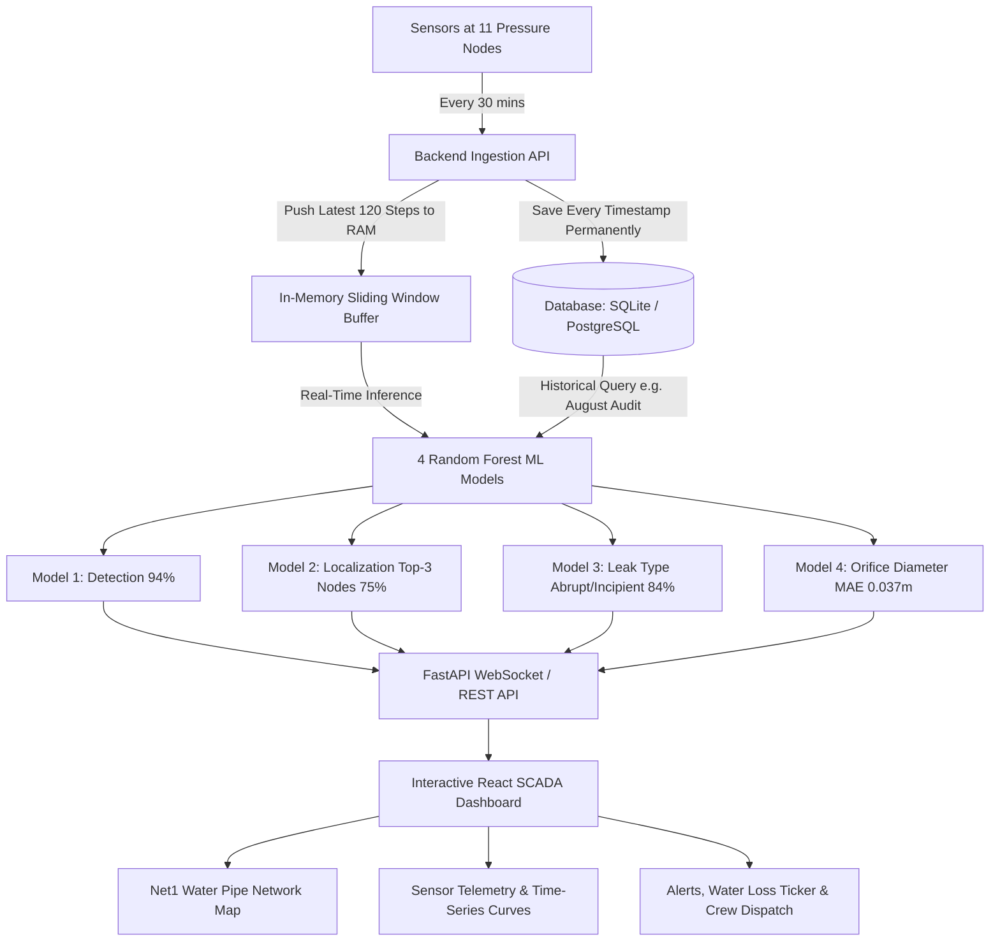

# Implementation Plan: NRW Water Leak Detection & Digital Twin System

A comprehensive blueprint for building the full-stack **Non-Revenue Water (NRW) Leak Detection & Network Monitoring Platform** (aligned with SIH1288 — Ministry of Jal Shakti).

---

## 1. System Overview & Architecture

Water distribution networks lose 30–50% of treated water due to undetected leaks, bursts, and pressure anomalies. The goal of this system is to combine **hydraulic network digital twinning (Net1 topology)** with **4 machine learning models (Random Forest V3/V2)** and **dual-mode operational intelligence**:
1. **Real-Time Digital Twin (Water Pipe Network)**: Interactive topological map showing 11 pressure sensor nodes, pipe links, animated flow vectors, dynamic pressure heatmaps, and pulsing leak beacons.
2. **Historical & Scenario Auditing**: Scan full-year simulations (17,520 timestamps / 365 days) or custom date ranges (e.g., *"Find leaks in August"*) to detect leak start dates, repair timestamps, location, and total water loss.
3. **Live SCADA Streamer & 120-Step Sliding Buffer**: Real-time 30-minute sensor ingestion with an in-memory rolling window buffer for instant alert generation.
4. **Permanent Database Storage**: Complete time-series sensor storage (SQLite / PostgreSQL) preserving all historical data for audits and regulatory reporting.
5. **NRW Loss Accounting & Automated Dispatch**: Calculation of water loss ($m^3/\text{day}$, $\text{Liters/hour}$ via Torricelli's orifice hydraulics) and 1-click field repair work orders.

---

## 2. Recommended Tech Stack

| Layer | Recommended Technology | Rationale |
|---|---|---|
| **Frontend Framework** | **React (Vite) + TypeScript** | High performance, instant reactivity, type-safe modular SCADA architecture. |
| **UI & Styling** | **TailwindCSS + Lucide Icons + Framer Motion** | Sleek modern dark industrial SCADA theme with smooth alert transitions and micro-animations. |
| **Network Visualization** | **Interactive SVG / Canvas (D3.js / React Flow)** | Custom high-fps rendering of Net1 network (11 sensor nodes, junctions, pipe conduits, animated flow vectors, and pulsing leak beacons). |
| **Time-Series Charts** | **Recharts / Chart.js** | Multi-node pressure curves, baseline comparison bands, and 120-step rolling window visualizations. |
| **Backend API** | **Python (FastAPI)** | High speed, native `scikit-learn`/`joblib`/`numpy`/`pandas` model execution, and async WebSocket streaming. |
| **Database** | **SQLite / PostgreSQL (SQLAlchemy)** | Permanent storage for all historical sensor timestamps, scenario catalogs, incident tickets, and audit logs. |
| **ML Models** | **Scikit-Learn / Joblib (4 RF Models)** | Model 1 (Detection), Model 2 (Localization), Model 3 (Classification), Model 4 (Diameter estimation). |

---

## 3. High-Value Features

### 1. Interactive Net1 Water Pipe Digital Twin (Network Map)
- **Topological Layout**: Displays all 11 sensor nodes (`10`, `11`, `12`, `13`, `21`, `22`, `23`, `31`, `32`, `33`), non-monitored junctions, pipes, reservoir, and water tanks.
- **Dynamic Pressure Gradients**: Nodes transition color dynamically based on pressure (Green = Nominal, Amber = Fluctuating, Red = Acute Drop / Leak).
- **Leak Beacon & Isolation Zone**: When a leak is localized (e.g., Node 21), a pulsating radar beacon highlights the primary node and the top 2 runner-up candidate nodes with dotted probability circles.
- **Node Drilldown**: Clicking any node opens an inspection drawer showing live pressure (kPa), 24h baseline curve, and elevation profile.

### 2. Dual-Mode Telemetry, Scenario Catalog Search & Incident Presets
- **Multi-Attribute Scenario Search & Filter Catalog**:
  - Search across all training/test scenarios (700 / 150 scenarios) using natural search terms and filters.
  - **Filter Dimensions**: By Node (`Node 21`, `Node 12`), Leak Type (`Abrupt Rupture`, `Incipient Leak`, with synonym support for `slow leak`, `burst`, `gradual creep`), Severity (`Major Burst`, `Micro Leak`, diameter thresholds), Month/Season (`August`, `Monsoon`, `Summer Peak`), and Scenario ID (e.g. `Scenario 111`).
- **Interactive Fault Injection (Manual Leak Trigger for Live Demos)**:
  - Click any node or use the Drill panel to trigger a manual leak with customizable size and type in real-time.
- **Live SCADA Monitoring Mode**: Real-time sensor stream playback with Play/Pause, speed multipliers (1x, 5x, 20x, 100x), and rolling 120-step window inference.
- **One-Click Emergency Presets (Demo Ready)**:
  - 🚨 *Major Main-Line Rupture (Node 21)*: Instant red alarm, high water loss.
  - ⚠️ *Incipient Hidden Leak (Node 12)*: Gradual pressure drift over 10 days, early AI catch.
  - ✅ *Normal Operation (Peak Morning Demand)*: High consumption without false alarms.
- **Historical Water Audit**: Select any month/timeframe (e.g., *"August 2023"*) to detect leak start dates, repair timestamps, and total water lost before repair.

### 3. Comprehensive AI Diagnostic Panel
- **Detection Status**: Instant status banner (`NORMAL` vs. `LEAK DETECTED`) with confidence metric.
- **Localization Probability Matrix**: Top-3 predicted nodes with visual probability bars (e.g., `Node 21 (67%)`, `Node 32 (21%)`, `Node 12 (12%)`).
- **Leak Dynamics & Characteristics**:
  - Type: **Abrupt Rupture** (immediate pressure plummet) vs. **Incipient Leak** (gradual creep).
  - Hole Diameter: Graphical pipe orifice gauge (in mm / meters).
  - Water Loss Estimator: Uses Torricelli's orifice hydraulics ($Q = C_d A \sqrt{2gH}$) to calculate loss in **Liters/hour** and **Estimated Financial Loss (₹ / $)**.

### 4. Incident Response & Automated Work Order Dispatch
- **Alarm Log**: Chronological record of all flagged events with acknowledged/resolved status.
- **1-Click Field Crew Dispatch**: Generates a standard Jal Shakti / Municipal work order with geocoded node ID, pipe IDs to isolate, estimated leak size, and suggested valve closure checklist.
- **Exportable PDF Report**: Download comprehensive technical audit report for municipal engineers.

---

## 4. Phased Implementation Roadmap

### **Phase 1: Backend Architecture, Dataset Ingestion & 4 ML Model Integration**
- **FastAPI Core & APIs**:
  - Initialize FastAPI application with CORS, Pydantic data contracts, and WebSocket stream manager.
  - Implement Net1 topological graph model (11 sensor nodes, non-monitored junctions, reservoir, tank, pipe connectivity adjacency list, and valve coordinates).
- **Data Pipeline & Persistence**:
  - Implement LeakDB scenario loader (supporting 17,520 timestamps $\times$ 11 pressure nodes per scenario).
  - Implement SQLite/PostgreSQL schema with SQLAlchemy for permanent historical time-series storage and incident logging.
  - Build the in-memory 120-step sliding window buffer for low-latency live telemetry inference.
- **Machine Learning Inference Engine**:
  - Load and orchestrate the 4 Random Forest models:
    - `Model 1`: Leak Detection (Binary classification & confidence).
    - `Model 2`: Top-3 Node Localization (Probability distribution across 11 nodes).
    - `Model 3`: Leak Dynamics (Abrupt Rupture vs. Incipient Leak).
    - `Model 4`: Orifice Hole Diameter regression (meters / mm).
  - Implement Torricelli orifice hydraulics engine to calculate instantaneous water loss ($Q = C_d A \sqrt{2gH}$) and economic loss rate ($₹/\text{hour}$).
- **API Endpoints**:
  - `GET /api/network/net1` (Topology structure).
  - `GET /api/scenarios` (Search & filter scenario catalog by node, type, severity, month, and keywords).
  - `POST /api/scenarios/historical-audit` (Full-year/custom date range scan for leak start/stop and total loss).
  - `POST /api/fault-inject` (Interactive real-time manual leak injection for live demos).
  - `WS /ws/scada-stream` (Real-time telemetry playback with speed multipliers).

### **Phase 2: Modern SCADA Frontend & Interactive Net1 Digital Twin**

**Step 1: Application Layout & Theme Foundation**
- Set up the global dark industrial SCADA theme (using TailwindCSS).
- Create the main layout shell: Sidebar (Navigation/Filters), Header (Ministry of Jal Shakti branding & status), and the Main Content Area.
- Create reusable foundational UI components (glassmorphic cards, status badges).

**Step 2: State Management & API Integration**
- Set up a state management solution for global application state (e.g., selected node, current scenario).
- Implement API services to fetch the Net1 topology (`GET /api/network/net1`).

**Step 3: Base Net1 Digital Twin Map Component**
- Use **React Flow** to render the interactive topological graph.
- Parse the Net1 topology JSON and render the static network: nodes (sensors, junctions, tanks, reservoirs) and edges (pipe conduits).
- Ensure zoom and pan functionality works seamlessly.

**Step 4: Dynamic & Interactive Graph Features**
- Implement dynamic node/edge styling (e.g., pressure color transitions from Green to Red).
- Add animated directional water flow vectors along the pipes.
- Create the pulsating radar leak beacon for localized nodes.
- Implement click handlers on nodes for interactivity.

**Step 5: Node Drilldown Drawer & Overlays**
- Build the Node Drilldown Drawer that slides in when a node is clicked, showing its metadata (elevation, ID, live pressure, etc.).
- Implement the Pipe Isolation Zone overlay (highlighting which valves to close).

### **Phase 3: Live SCADA Telemetry, Search Catalog & Simulation Controls**
- **Simulation Control Toolbar**:
  - Dual-mode toggle: `Live SCADA Stream` vs. `Scenario Lab / Historical Audit`.
  - Media player controls: `Play`, `Pause`, `Step Next`, and speed multipliers (`1x`, `5x`, `20x`, `100x`).
  - 365-day (17,520-step) interactive timeline scrubber with leak event marker annotations.
- **Multi-Attribute Scenario Search & Filter Catalog** `[COMPLETED]`:
  - Natural query search bar with smart synonym mapping (`"slow leak"` $\rightarrow$ Incipient, `"pipe burst"` $\rightarrow$ Abrupt, node names e.g. `"node 12"`, severity keywords e.g. `"severe"`, `"minor"`).
  - Quick suggestion pills (`💥 Pipe Burst`, `💧 Slow Leak`, `📍 Node 12 Burst`, `📍 Node 31 Leak`, `🔥 Severe Rupture`).
  - Slide-out glassmorphic drawer with filter controls (leak type tabs, node dropdown, severity selector, reset).
  - Rich scenario incident cards displaying scenario ID, junction, orifice diameter, severity rating, description, and 1-click **Load Scenario** button.
  - Multi-event compound incident support: Groups multi-pipe ruptures with `Compound Incident` badge and multi-node display.
  - Full backend pagination & caching across all 741+ LeakDB benchmark incidents (`GET /api/scenarios/`, `POST /api/scenarios/select`).
  - Complete 4-Phase Incident Lifecycle (96 timesteps / 48 hours):
    1. `[Pre-Incident Baseline]` (Steps 0–16): Nominal diurnal baseline flow.
    2. `[Incipient Development / Rupture]` (Steps 17–60): Progressive pressure drops lasting across days; AI detects leak.
    3. `[Field Repair Completed]` (Teal marker at step $N_{repair}$): Physical leak patched, isolation valves secured.
    4. `[Post-Repair Hydraulic Recovery]` (Steps 61–96): Full hydrological restoration to nominal baseline pressures.
  - Interactive timeline scrubber annotations: Red incident window bars, vibrant teal repair completion notch, and dynamic status badges (`ANOMALY ACTIVE`, `REPAIR COMPLETED: HYDRAULIC RECOVERY`, `PRE-INCIDENT NOMINAL BASELINE`).
  - WebSocket instant dataset hot-loading (`action: "load_scenario"`), syncing timeline scrubber markers and live AI diagnostic evaluation.
- **Interactive Fault Injection (Manual Leak Demo Panel)** `[COMPLETED]`:
  - 1-click trigger to inject a leak at any selected node live on screen with customizable leak dynamics (`Abrupt` vs. `Incipient`) and orifice diameter (5mm to 100mm presets or custom slider).
  - Physics-based pressure drop overlay on backend (`apply_fault_overlay`): Torricelli orifice discharge formula reducing hydraulic head and diffusing pressure drop to adjacent network junctions.
  - Real-time bidirectional WebSocket control (`inject_fault` / `clear_fault`) plus REST fallback (`POST /api/scenarios/fault-inject`).
  - Slide-up glassmorphic Fault Lab panel with live discharge loss metrics ($m^3$/hr, L/min, and financial loss in ₹/hr).
  - Live visual feedback: Pulsing amber-red `⚡ INJECTED` node badge on Net1 Digital Twin map canvas, red glowing `⚡ Fault Lab` toolbar trigger button, and header status badge.
  - Instant AI diagnostic confirmation: Live indicator verifying whether the AI detection model picked up the injected leak and correctly located the target junction.
- **Time-Series Telemetry Charts (Professional 4-Chart SCADA Suite)** `[COMPLETED]`:
  - **Chart 1 — Pressure & Diurnal Tolerance Corridor**: Live measured hydraulic pressure ($mH_2O$) at selected junction, historical nominal baseline, shaded green safe envelope ($\pm 1.5\text{ mH}_2\text{O}$), and synchronized vertical reference playback cursor.
  - **Chart 2 — Multi-Node Hydraulic Gradient ($\Delta P$)**: Comparative multi-junction line chart demonstrating localized pressure plunge at target node vs. attenuated neighbor drop vs. stable reference source.
  - **Chart 3 — Real-Time Flow Discharge Rate**: Step-area chart tracking Torricelli physical water loss rate ($L/h$ and $m^3/h$) and financial burn rate (₹/hr), dropping instantly to zero at the field repair step.
  - **Chart 4 — Cumulative Water Loss Volumetric Growth**: Monotonic area curve compounding total water lost ($m^3$) and cumulative financial impact (₹ INR), flattening into a permanent plateau when repair is verified.
  - Rolling 120-step sliding history buffer in Zustand store (`telemetryHistory`), synchronized with WebSocket stream, map node clicks, and scenario timeline scrubbing.
  - Clean unified layout: **2×2 Glassmorphic Grid** displaying all 4 synchronized telemetry dimensions simultaneously with live junction selection.
- **True Live SCADA Engine & 120-Step DVR Time-Machine** `[COMPLETED]`:
  - **Decoupled Architecture**: Clean separation between **Live SCADA** nominal monitoring stream (`activeScenarioId = null`, status `NORMAL`, live clock timestamps) and **Scenario Lab** historical incident catalog.
  - **Continuous EPANET Streamer & Speed Multipliers**: Real-time nominal baseline generator with Net1 diurnal demand curves and sensor micro-jitter ($\pm 0.1\text{ mH}_2\text{O}$), accelerated by 1x, 5x, 20x, 100x speed controls.
  - **Dynamic Fault Lab Injection**: Faults injected at any junction (e.g., Node 23) apply physical Torricelli headloss and EPANET impedance $\Delta H$ in real time; ML models detect the leak and prioritize the target node; clearing the fault recovers instantly.
  - **120-Step Rolling Window & DVR Time-Machine**: Operators can rewind/pause across the rolling 120-step buffer to inspect earlier states on the Digital Twin Map and charts, and return to live streaming via the `RETURN TO LIVE 🔴` button.
  - **SQLite Historian**: Telemetry packets, ML diagnostic inference, and fault state are logged to `scada_live_historian` in `leakdb.sqlite`.
  - **Localized Deficit & Temporal Dynamics Calibration** `[COMPLETED]`:
    - Updated **Mean Hydraulic Head** card to monitor minimum junction head ($H_{\text{min}}$) and warn operators with a `Critical Deficit (Node X)` badge rather than showing misleading city-wide "Stable" averages during single-point pipe bursts.
    - Upgraded AI Diagnostic Engine with temporal rate-of-change ($\frac{\Delta P}{\Delta t}$) tracking and physical hydraulic magnitude constraints so major bursts (e.g. 100mm, $\Delta P \ge 10\text{m}$) are correctly identified as **Abrupt Rupture** from sensor physics without cheating.

### **Phase 4: AI Diagnostic Panel, NRW Loss Accounting & Work Order Dispatch**
- **Comprehensive AI Diagnostic Panel**:
  - Live Detection status badge (`NORMAL` vs. `CRITICAL LEAK DETECTED`) with confidence bar.
  - Localization probability breakdown with ranked Top-3 candidate nodes.
  - Leak dynamic tag (`Abrupt Rupture` vs. `Incipient Leak`) and graphical orifice diameter gauge.
- **NRW Water Loss & Financial Loss Ticker**:
  - Real-time ticker showing accumulated water lost ($m^3$, Liters/min) and financial loss in INR (₹).
- **Incident Management & Jal Shakti Work Order Dispatch**:
  - Chronological alarm log with status tracking (`New`, `Acknowledged`, `Dispatched`, `Resolved`).
  - 1-Click Field Crew Dispatch modal: Generates official Jal Shakti work order with GPS coordinates, pipe IDs to isolate, valve closure checklist, and estimated equipment needed.
  - Technical Audit PDF / Print export for municipal water engineers.

---

## 5. Verification & Testing Plan

### Automated Tests
- **API Tests**: `pytest` test suite verifying:
  - `/api/scenarios` list retrieval and preset metadata.
  - `/api/network/net1` topology structure (11 sensor nodes, all pipe edges).
  - `/api/analyze` and `/api/stream/step` returning valid predictions with Top-3 probabilities and diameter estimates.
- **Frontend Unit/Build Tests**: `npm run build` validation, ensuring zero TypeScript compilation errors.

### Manual Verification
1. **Topology Visual Check**: Verify Net1 network renders with all 11 sensor nodes correctly labeled and connected by pipe links.
2. **Scenario Playback**: Load a test scenario (e.g. Scenario-111), press Play, and observe pressure drops occurring at the exact leak timesteps.
3. **Leak Alarm Trigger**: Verify that when the leak window begins, the UI raises an audible/visual alarm, highlights Node 21 in red, displays top-3 candidate nodes, and calculates water loss.
4. **Historical Query Test**: Request an audit for an emergency window and verify that the UI pinpoints the exact start date, repair date, and total water lost.
