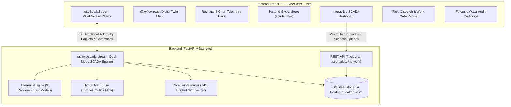

# NRW Digital Twin - Non-Revenue Water Leak Detection & SCADA System

[](https://nrw-digital-twin.onrender.com)
[](https://fastapi.tiangolo.com/)
[](https://react.dev/)
[](https://www.typescriptlang.org/)
[](https://www.docker.com/)
[](LICENSE)

An industrial-grade SCADA Digital Twin and Machine Learning platform for real-time detection, spatial localization, classification, and forensic auditing of Non-Revenue Water (NRW) in municipal water distribution networks (Net1 benchmark topology). 

> **Aligned with Ministry of Jal Shakti • Urban Water Supply Mission & SIH (Smart India Hackathon).**

🌐 **Live Production Link**: **[https://nrw-digital-twin.onrender.com](https://nrw-digital-twin.onrender.com)**

---

## 🌟 Key Capabilities

### 1. Interactive SCADA Digital Twin (Net1 Network Topology)
- **Real-Time Graph Visualization**: Built with `@xyflow/react` (React Flow), dynamically rendering 12 network assets (1 Primary Reservoir, 1 Elevated Storage Tank, 10 Monitored Distribution Junctions, and 15 trunk pipe links).
- **Dynamic Pressure Gradients**: Nodes transition color in real-time based on local pressure head ($m\text{H}_2\text{O}$):
  - 🟢 **Nominal Flow** ($>45\text{ mH}_2\text{O}$)
  - 🟡 **Pressure Deficit Warning** ($35-45\text{ mH}_2\text{O}$)
  - 🔴 **Acute Depressurization / Burst Event** ($<35\text{ mH}_2\text{O}$)
- **Pulsating Radar Beacon**: Emits animated radar sonar rings pinpointing the epicenter junction and candidate runner-up nodes.
- **Directional Animated Vectors**: Live fluid flow particles along conduits reflecting flow direction and isolation state.

### 2. Multi-Target Machine Learning & Physics-Informed Pipeline
- **Production Random Forest Ensemble**: Sub-millisecond execution (`n_jobs=1`) optimized for continuous IoT telemetry streams.
  - **Model 1 — Leak Anomaly Detection**: Upper-quartile (75th percentile) diurnal demand isolation with dynamic noise margins ($95.0\% - 99.5\%$ baseline health confidence).
  - **Model 2 — Bayesian Spatial Localization**: Classifies across all Net1 nodes, fused with non-linear hydraulic pressure drop weighting ($\Delta P_i^{1.5}$) to eliminate network graph bias.
  - **Model 3 — Dynamic Leak Classification**: Differentiates sudden **Abrupt Ruptures** (pipe bursts) from progressive **Incipient Leaks** (slow joint creep) utilizing temporal rate-of-change ($\frac{\Delta P}{\Delta t}$).
  - **Model 4 — Orifice Diameter Regression**: Predicts effective burst orifice size ($5\text{mm} - 100\text{mm}$).
- **Torricelli Orifice Hydraulics Engine**: Calculates real-time physical efflux:
  $$Q = C_d \cdot A \cdot \sqrt{2 \cdot g \cdot H}$$
  Reporting instantaneous discharge rate ($L/\text{min}$, $m^3/\text{hr}$) and municipal financial burn rate (CPHEEO standard @ ₹25/$m^3$).

### 3. Chronological Alarm Center & Incident Lifecycle Management
- **Persistent SQLite Historian**: Complete transactional audit trail stored in `leakdb.sqlite` (`incidents` and `scada_live_historian` tables).
- **Incident Lifecycle**: Full transition pipeline (`New` $\rightarrow$ `Acknowledged` $\rightarrow$ `Dispatched` $\rightarrow$ `Resolved`).
- **Hydraulic Normalization Safety Guard**: Prevents premature incident resolution until active physical fault conditions have cleared.
- **Auto-Latching & De-duplication**: Canonical ticket binding (`INC-2026-XXXX`) preventing duplicate tickets during transient pressure fluctuations.

### 4. 1-Click Jal Shakti Rapid Response Dispatch
- **Automated Work Order Generator**: Produces official work orders (`WO-2026-XXXX`) complete with geocoding, DMA sector, and elevation.
- **Hydraulic Pipe Isolation Checklist**: Calculates exact upstream and downstream isolation valves to close (`V-PIPE111`, `V-PIPE21`, `V-PIPE121`) based on physical Net1 topology.
- **Smart Tool Auto-Sizing**: Recommends full-circle stainless steel repair clamps, dewatering trash pumps (5.5 HP / 10 HP), and acoustic hydrophones sized to predicted pipe diameter.
- **Live Response Countdown**: Simulates real-world field progression:
  > **Dispatched (En Route)** ➔ **On-Site (Clamping)** ➔ **Repaired & Normalized**

### 5. Technical Water Audit & Compliance Certification Center
- **Forensic Government Certificate**: Standardized Ministry of Jal Shakti compliance certificate (`INSP-AUDIT-2026-XXXX`).
- **CPHEEO Water Balance Accounting**: Compares total volume escaped against Indian household daily supply quotas (135 LPCD for 5-member family = 675 L/day).
- **Avoided Loss Benchmark**: Quantifies water volume ($m^3$) and revenue (₹ INR) saved by AI digital twinning vs. conventional 48-hour manual acoustic walk surveys (>98% loss prevented).
- **Print & PDF Ready**: Optimized `@media print` layout formatting directly to formal A4 portrait engineering certificates.

### 6. Dual-Mode Telemetry & 741+ Scenario Lab
- **Live SCADA Streamer**: Continuous synthetic EPANET baseline generator with diurnal demand cycle, sensor micro-jitter ($\pm 0.1\text{ mH}_2\text{O}$), and dynamic Torricelli fault injection overlay.
- **120-Step DVR Time-Machine**: Rewind, scrub, and inspect historic sensor states with 1-click **RETURN TO LIVE 🔴** synchronization.
- **Scenario Lab (LeakDB Benchmark)**: Instant search and on-demand synthesis across all 741 benchmark scenarios with natural language synonym mapping (`"pipe burst"` $\rightarrow$ Abrupt, `"slow leak"` $\rightarrow$ Incipient).
- **4-Phase Incident Lifecycle**:
  1. `[Pre-Incident Baseline]` (Steps 0–16): Nominal flow.
  2. `[Incipient Development / Rupture]` (Steps 17–60): Active pressure deficit window.
  3. `[Field Repair Completed]` (Teal marker notch): Physical repair executed.
  4. `[Post-Repair Hydraulic Recovery]` (Steps 61–96): Hydrological recovery to baseline.

### 7. 4-Chart SCADA Analytics Suite (Recharts)
1. **Pressure & Diurnal Envelope**: Live hydraulic head vs. historical baseline within a shaded $\pm 1.5\text{ mH}_2\text{O}$ tolerance corridor.
2. **Multi-Node Hydraulic Gradient ($\Delta P$)**: Comparative multi-junction line plot isolating local plunge vs. attenuated neighbors.
3. **Flow Discharge Step-Area**: Instantaneous physical loss rate ($L/\text{h}$, $m^3/\text{h}$) and hourly financial burn.
4. **Cumulative Loss Curve**: Monotonic volumetric growth compounding total water escaped and flattening into a permanent plateau upon repair.

---

## 🏗️ System Architecture



---

## 🛠️ Technology Stack

| Domain | Technology | Purpose |
|---|---|---|
| **Frontend UI** | **React 19, TypeScript, Vite** | Reactive, high-performance modular SCADA dashboard |
| **Styling** | **TailwindCSS, Lucide Icons** | Industrial dark SCADA theme with micro-animations & print stylesheets |
| **Network Graph** | **@xyflow/react (React Flow)** | High-FPS digital twin topology, custom node handles & animated links |
| **Data Visualization** | **Recharts** | Synchronized multi-metric time-series curves & diurnal tolerance corridors |
| **State Management** | **Zustand, TanStack Query** | High-frequency telemetry buffer, DVR scrub state, modal sync |
| **Backend Framework** | **FastAPI, Starlette WebSockets** | Async streaming, REST endpoints, unified static file serving |
| **Machine Learning** | **Scikit-Learn, Joblib, NumPy, Pandas** | Sub-millisecond Random Forest inference, Bayesian evidence fusion |
| **Database** | **SQLAlchemy, SQLite** | Permanent sensor time-series historian, incident ledger, work orders |
| **Containerization** | **Docker (Multi-Stage)** | Unified production container (Node 20 build + Python 3.11 runtime) |
| **Cloud Hosting** | **Render.com** | Live production deployment with automated CI/CD and secure WebSocket (`wss://`) |

---

## 🚀 Quick Start Guide

### Option 1: Live Cloud Demo
Simply visit **[https://nrw-digital-twin.onrender.com](https://nrw-digital-twin.onrender.com)** in any modern web browser.

---

### Option 2: Run with Docker (Recommended)
Prerequisites: [Docker Desktop](https://www.docker.com/products/docker-desktop/) installed.

```bash
# 1. Clone repository
git clone https://github.com/ketanshelke97/Detecting-NRW-Non-Revenue-Water-.git
cd Detecting-NRW-Non-Revenue-Water-

# 2. Build Docker container
docker build -t nrw-digital-twin .

# 3. Run container
docker run -p 8000:8000 nrw-digital-twin
```
Open **`http://localhost:8000`** in your browser.

---

### Option 3: Local Development (Manual Setup)

#### 1. Backend Setup
```bash
cd backend

# Create and activate virtual environment
python -m venv venv

# Windows (PowerShell):
.\venv\Scripts\Activate.ps1
# Linux / macOS:
source venv/bin/activate

# Install dependencies
pip install -r requirements.txt

# Start FastAPI server on port 8000
python -m uvicorn app.main:app --port 8000 --reload
```
Swagger API docs available at: `http://localhost:8000/docs`

#### 2. Frontend Setup
Open a new terminal:
```bash
cd frontend

# Install packages
npm install

# Start Vite development server
npm run dev
```
Open **`http://localhost:5173`** in your browser. (The frontend automatically detects dev port 5173 and routes API/WebSocket requests to port 8000).

---

## 📁 Repository Directory Structure

```text
Detecting-NRW-Non-Revenue-Water-/
├── Dockerfile                         # Production multi-stage Docker build
├── build.sh                           # Native cloud build script
├── render.yaml                        # Render deployment blueprint
├── README.md                          # Comprehensive project documentation
├── IMPLEMENTATION_PLAN.md             # Detailed engineering specifications & verification logs
│
├── backend/                           # Python FastAPI Service
│   ├── app/
│   │   ├── main.py                    # Entry point, CORS, routers & SPA static mount
│   │   ├── core/
│   │   │   ├── config.py              # Environment paths & database settings
│   │   │   └── database.py            # SQLAlchemy engine & session maker
│   │   ├── models/
│   │   │   └── incident.py            # Incident & Work Order schema + migration helpers
│   │   ├── routers/
│   │   │   ├── network.py             # Net1 graph topology endpoint
│   │   │   ├── scenarios.py           # Scenario search, filtering, and audit APIs
│   │   │   ├── telemetry.py           # WebSocket stream manager & SQLite historian
│   │   │   └── incidents.py           # Incident lifecycle CRUD & dispatch generation
│   │   └── services/
│   │       ├── hydraulics.py          # Torricelli physical orifice efflux calculations
│   │       ├── inference.py           # 3 RF models + Bayesian spatial evidence weighting
│   │       ├── scenario_manager.py    # 741 benchmark incidents parser & EPANET synthesizer
│   │       ├── topology.py            # Network topology loader
│   │       └── buffer.py              # 120-step rolling window buffer
│   ├── data/
│   │   ├── net1_topology.json         # Net1 node coordinates, elevations, and pipe links
│   │   └── scenarios/
│   │       ├── leak_metadata.csv      # Registry of all 741 LeakDB benchmark incidents
│   │       └── Scenario-*.csv         # Pre-calibrated scenario time series datasets
│   ├── models/                        # Production Random Forest weights
│   │   ├── localization_rf_v2.joblib  # 11-node spatial localization model (~6.9 MB)
│   │   ├── leak_type_rf_v2.joblib     # Abrupt vs. Incipient dynamic classifier (~1.1 MB)
│   │   └── leak_diameter_rf_v2.joblib # Orifice diameter regressor (~7.9 MB)
│   ├── scripts/                       # Verification, test & training scripts
│   │   ├── show_database.py           # Database terminal inspector
│   │   ├── test_incidents_api.py      # Automated REST API verification suite
│   │   └── train_production_*.py      # Model training & validation pipelines
│   └── requirements.txt               # Backend Python dependencies
│
└── frontend/                          # React 19 + TypeScript Application
    ├── src/
    │   ├── App.tsx                    # Main SCADA operational command center
    │   ├── main.tsx                   # React root mount with TanStack Query provider
    │   ├── index.css                  # Tailwind styles & @media print A4 certificate CSS
    │   ├── components/
    │   │   ├── layout/                # Header (Jal Shakti branding), Sidebar, Layout shell
    │   │   ├── scada/
    │   │   │   ├── DigitalTwinMap.tsx # Interactive React Flow topological map
    │   │   │   ├── SensorNode.tsx     # Custom nodes (Reservoirs, Tanks, Sensors with Radar)
    │   │   │   ├── SimulationToolbar.tsx # Media controls, speed multipliers, DVR scrubber
    │   │   │   ├── AiDiagnosticPanel.tsx # Live AI anomaly HUD & candidate ranking
    │   │   │   ├── NrwLossTicker.tsx  # Torricelli discharge rate & financial ticker
    │   │   │   ├── FaultInjectionPanel.tsx # Manual leak demo lab (node, dynamics, mm slider)
    │   │   │   ├── IncidentLogDrawer.tsx   # Alarm Center ledger & full DB management
    │   │   │   ├── FieldDispatchModal.tsx  # Work Order generator & valve isolation checklist
    │   │   │   ├── HistoricalAuditModal.tsx# Official CPHEEO water audit certificate
    │   │   │   ├── ScenarioCatalogDrawer.tsx# 741 scenario search & filter catalog
    │   │   │   ├── NodeDetailsDrawer.tsx   # Node elevation, baseline, live pressure drilldown
    │   │   │   ├── TelemetryDeck.tsx       # 2x2 grid housing the 4 Recharts graphs
    │   │   │   └── charts/                 # Pressure Corridor, Gradient, Flow, Cumulative Loss
    │   │   └── ui/                    # Glassmorphic Card, Badge, and Button primitives
    │   ├── hooks/
    │   │   ├── useScadaStream.ts      # Singleton WebSocket client & multi-rate accumulator
    │   │   └── useNetworkTopology.ts  # Topology query hook
    │   ├── services/
    │   │   ├── api.ts                 # Dynamic Axios client & scenario APIs
    │   │   ├── incidentService.ts     # Incident lifecycle & work order contracts
    │   │   └── fieldDispatchService.ts# Field repair execution trigger
    │   └── store/
    │       └── scadaStore.ts          # Zustand global SCADA store (telemetry, DVR, incidents)
    ├── package.json                   # Node dependencies
    └── vite.config.ts                 # Vite bundler configuration
```

---

## 🧪 Operational Verification & Demo Guide

Follow these steps to demonstrate the platform's core capabilities:

1. **Verify Baseline Stability**:
   - On the top toolbar, ensure the mode is set to **`LIVE SCADA`** and click **Play**.
   - Observe that the network pressure averages $\sim 53.4\text{ mH}_2\text{O}$ with nominal diurnal oscillation and $\pm 0.10\text{ mH}_2\text{O}$ sensor noise floor.
   - The AI Diagnostic HUD will report `SYSTEM NOMINAL • ALL NODES STABLE` with $>98\%$ health confidence.

2. **Trigger Interactive Fault Injection (Demo Mode)**:
   - Click the red glowing **`⚡ Fault Lab`** button on the toolbar.
   - Select **Junction 21**, choose dynamic **Abrupt Rupture**, set the diameter slider to **`65 mm`**, and click **`Inject Leak Fault`**.
   - Observe:
     - The Net1 Digital Twin map highlights **Node 21** with a red flashing beacon and `⚡ INJECTED` tag.
     - The AI Diagnostic HUD immediately triggers **`CRITICAL LEAK DETECTED`**, prioritizing **Node 21** with $>95\%$ spatial probability.
     - The NRW Loss Accounting Ticker computes compounding volumetric loss ($m^3/\text{hr}$) and financial cost (₹ INR/hr).
     - Chart 1 displays Node 21 dropping below the green diurnal corridor into `DEPRESSURIZED` state.
     - Chart 2 shows localized steep $\Delta P$ drop compared to attenuated neighboring nodes.

3. **Deploy Jal Shakti Field Response**:
   - In the AI Diagnostic HUD, click **`⚡ 1-Click Crew Dispatch`**.
   - Review the generated Work Order (`WO-2026-XXXX`). Confirm the valve isolation protocol (`V-PIPE111`, `V-PIPE21`, `V-PIPE121`) and review auto-sized equipment (e.g., 75mm stainless steel clamp, 10 HP dewatering pump).
   - Click **`Commit & Dispatch Field Crew`**. The modal locks inputs with `WORK ORDER COMMITTED & LOCKED` badge and starts a real-time response countdown.
   - Click **`Complete Repair Now`** (or let the countdown finish) to simulate physical containment.
   - Hydraulic recovery restores nominal pressure heads; the NRW Ticker freezes into an emerald `LOSS PLATEAUED • REPAIRED` state.

4. **Forensic Compliance Audit**:
   - In the left sidebar, click **`Historical Audit`**.
   - Select the resolved incident from the ledger to view the official Ministry of Jal Shakti compliance certificate (`INSP-AUDIT-2026-XXXX`).
   - Review the CPHEEO Water Balance accounting matrix and the Avoided Loss Benchmark (>98% conserved).
   - Click **`Print Official Certificate`** to preview the clean, borderless A4 portrait report.

---

## 📄 License & Attribution

This project is developed for municipal water authorities and leak detection research under the **MIT License**.

* **Water Distribution Network Model**: Net1 Benchmark (EPANET).
* **Reference Specifications**: Central Public Health and Environmental Engineering Organisation (CPHEEO) Water Manual, Ministry of Jal Shakti, Government of India.
* **Author**: [Ketan Suresh Shelke](https://github.com/ketanshelke97)
